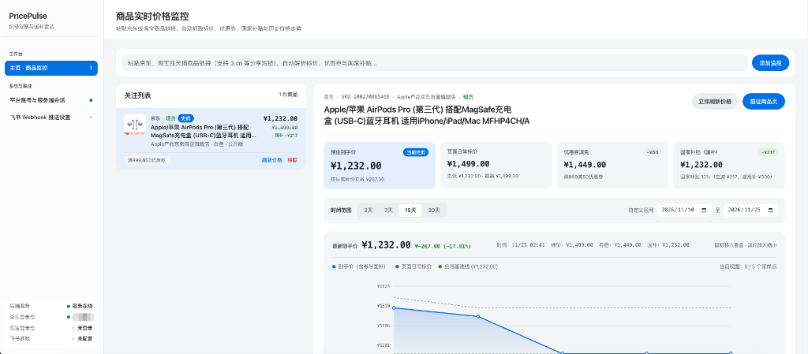
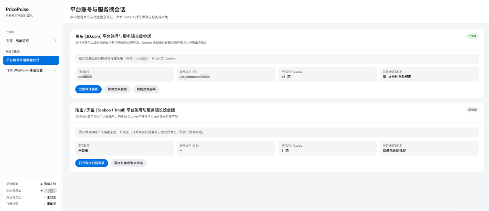
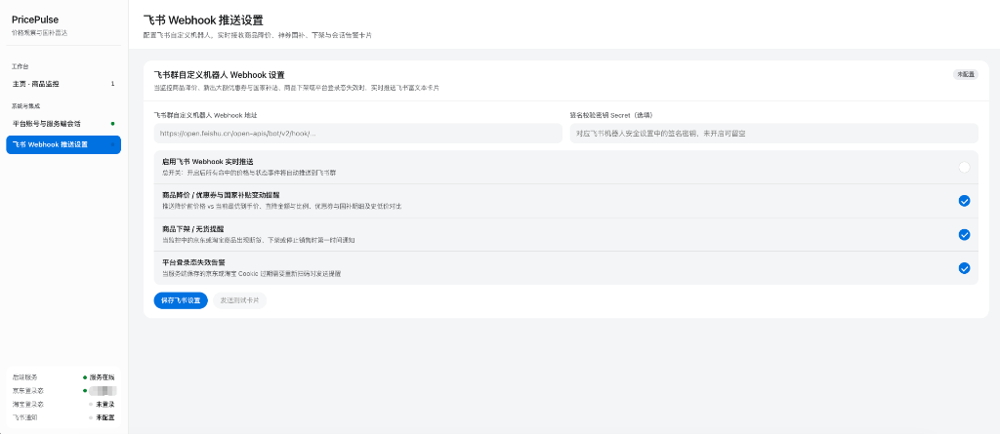
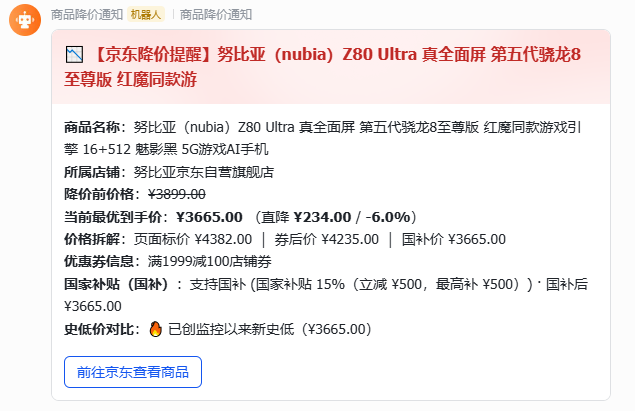

# PricePulse（价格脉搏 · 价格观察室）

<p align="left">
  
  = 22" />
  
  
</p>

**PricePulse** 是一个完全自托管（Self-Hosted）的**网购商品价格观察室**。把京东、淘宝或天猫的商品加进来，就能盯住同一个规格的价格走势，查看券后价、国补价和预估到手价，并把降价或下架消息推送到自己的飞书群。

复制商品链接或 App 分享短链，粘贴到网页即可发起采集。到手价以商品页面实际展示的优惠为依据。遇到淘宝商品页人机验证，可以在授权内网打开实时画面，手动验证后点「确定」，继续采集原来的商品。京东商品页频控、平台验证和登录过期也各有对应的提示。

---

## 🖼️ 界面预览 (UI Screenshots)

### 1. 主页 · 商品实时价格监控与交互式走势图
> 支持一键采集商品标价、页面展示的优惠券与国补信息。内置 Apple「股市」风格的交互式价格走势图，支持十字准星看盘、滚轮缩放与时间区间筛选。



### 2. 平台账号与服务端长效会话
> 集中管理京东与淘宝/天猫登录态，提供网页扫码、手机号短信验证码和云端实时操作入口。登录凭证持久化保存在部署设备上，由服务端定时保活。



### 3. 飞书 Webhook 实时卡片推送设置
> 接入飞书群自定义机器人 Webhook，发送商品降价、下架断货与京东会话失效提醒。



### 4. 飞书群降价通知推送效果
> 当商品触发降价或刷新史低时，飞书机器人自动推送交互式富文本卡片，直观呈现降价前价格 vs 当前最优到手价、直降金额与比例、页面标价/券后价/国补价三阶拆解、史低对比及一键直达商品页按钮。



---

## ✨ 核心特性

- **🔗 链接即贴即查** 支持京东、淘宝/天猫商品链接及 `3.cn`、`u.jd.com` 等分享短链。同款商品的不同规格可以分别加入监控。
- **🟢 国补价与优惠券拆解** 对比页面标价、券后价与国补后预估到手价。京东优先读取商品页明确展示的到手价或国补领后价。
- **📈 交互式历史价格走势图** 每 15 分钟巡检已监控商品，记录成功采集的价格。图表支持对比页面标价、预估到手价和历史低点，首次导入的历史曲线包含参考价格。
- **🔐 网页内登录与服务端保活** 提供京东、淘宝/天猫扫码和短信验证码登录入口。遇到平台安全验证时，可以通过网页里的云端实时画面手动操作。Cookie 保存在服务端的 `.local-data/` 目录，服务端每 10 分钟执行一次保活。
- **🧩 淘宝商品页手动验证** 在授权内网添加或刷新商品，遇到可交互的淘宝验证页会自动弹窗。手动完成验证后点「确定」，系统从原商品页继续采集，成功后自动关窗。
- **⚙️ 采集排队与明确提示** 相同规格的并发请求共用一次采集，下一条手动请求可以短暂排队。遇到超时、平台频控或登录过期时，网页会提示对应原因。采集和登录共用服务端 Chromium，空闲后自动释放。
- **🔔 飞书 Webhook 实时富文本卡片推送**
  - **商品降价**时对比本次与上次预估到手价，附带优惠信息、降幅与商品链接。
  - **商品下架 / 无货**时发送提醒。
  - **京东登录态失效**经确认后发送一次提醒，便于及时恢复监控。
- **⚖️ 全网实时自动比价（持续迭代中）**：规划支持同一件商品跨店铺、跨平台（京东 ↔ 淘宝）实时比价，自动定位全网最低到手渠道。

---

## 🤖 一键让你的 AI Agent 自动部署（私有服务器 / 私有云 / NAS）

你可以直接把下面这段提示词复制发给你的 **AI Agent**（如 **Claude Code、Cursor、Codex、Antigravity、OpenClaw、Cline** 等），让 Agent 自动帮你把本项目部署到你的 **Linux 私有服务器、私有云、Mac mini 家庭服务器，或群晖 (Synology) / 绿联 (UGREEN) / 飞牛 (fnOS) / 威联通 (QNAP) NAS** 上：

### 📋 复制以下 Prompt 发给你的 Agent：

```markdown
请帮我将开源项目 PricePulse 部署到当前设备（私有服务器 / 私有云 / NAS）上，仓库地址为：
https://github.com/RainAnz1/PricePulse.git

请按以下步骤自动完成环境检查与部署：
1. 克隆仓库到本地目录：
   git clone https://github.com/RainAnz1/PricePulse.git && cd PricePulse
2. 选择最适合当前机器的部署方式：
   - 【方式 A：Docker / NAS 容器部署（推荐用于群晖、绿联、飞牛 fnOS、威联通 NAS 或已安装 Docker 的服务器）】
     直接执行 `docker compose up -d --build`，确认容器 `price-pulse` 启动成功，并将 `./local-data` 挂载至容器内 `/app/.local-data` 以持久化保存京东/淘宝登录态 Cookie、监控商品历史价格和飞书 Webhook 配置。
   - 【方式 B：Node.js 原生常驻部署（适用于已有 Node.js >= 22 的服务器或 Mac / Linux 主机）】
     执行 `npm install && npm run build`，再使用 PM2、systemd 或后台进程常驻运行 `NODE_ENV=production npm run start -w @price-drop/api`。生产模式的 Web 面板和 API 共用 `3001` 端口。
3. 部署完成后，请执行 `curl -fsS http://127.0.0.1:3001/api/health` 验证健康状态，并告诉我实际的 Web 访问地址（默认端口 `3001`）。
```

---

## 🛠️ 手动安装与部署指南

### 方式一：本地 / 私有服务器直接运行 (Node.js >= 22)

```bash
# 1. 克隆仓库
git clone https://github.com/RainAnz1/PricePulse.git
cd PricePulse

# 2. 安装依赖
npm install

# 3. 启动服务（前端端口 8090，后端 API 端口 3001）
npm run dev
```

启动后在浏览器访问：**http://127.0.0.1:8090**

- **类型检查**：`npm run typecheck`
- **生产构建**：`npm run build`
- **链接解析自测**：`node apps/api/test-product-url.cjs`

### 方式二：Docker / NAS（群晖 / 绿联 / 飞牛 fnOS / Unraid）部署

```bash
git clone https://github.com/RainAnz1/PricePulse.git
cd PricePulse
docker compose up -d --build
```

- **Web 面板**默认通过 `http://<你的NAS或服务器IP>:3001` 访问。
- **数据持久化目录**：当前目录下的 `./local-data`（包含你的扫码登录 Cookie、商品历史价格及飞书 Webhook 配置，容器升级或重启不会丢失）。
- **商品验证弹窗**可通过容器环境变量 `PRICEPULSE_VERIFICATION_LAN_CIDR` 启用，例如设置为 `192.168.1.0/24`，并从对应的 IPv4 内网直接访问面板。

### 📦 公开 Docker 镜像

GitHub Actions 负责类型检查、回归测试、容器冒烟测试及镜像构建。主分支构建发布到 `ghcr.io/rainanz1/pricepulse:latest`，阿里云成都镜像按版本标签同步。两处镜像均可公开拉取，部署由使用者手动执行。

**中国大陆推荐 · 阿里云成都（Linux amd64）**

```bash
docker pull registry.cn-chengdu.aliyuncs.com/rainy-images/pricepulse:4ee4330e5f95
```

**海外推荐 · GitHub Container Registry**

```bash
docker pull ghcr.io/rainanz1/pricepulse:latest
```

---

## 🔒 隐私与数据安全说明

1. **零第三方上传**：你在网页端扫码或验证码登录获取的京东/淘宝 Cookie、飞书 Webhook 密钥仅保存在你部署设备本地的 `.local-data/` 目录下，绝不经过任何第三方中转服务器。
2. **严格的 `.gitignore` 防护**：仓库已默认忽略所有 `.local-data/`、`*cookie*`、`*session*.json`、`*feishu*.json`、`.env` 等敏感文件，防止在二次开发或提交 PR 时意外泄露个人凭证。
3. **公网部署建议**：若将本项目部署在有公网 IP 的云服务器上，请配合 Nginx / Caddy / Lucky 开启 Basic Auth 访问密码或仅通过 Tailscale / WireGuard 内网访问，切勿将已登录个人电商账号的面板无鉴权暴露在公网。详见 [SECURITY.md](./SECURITY.md)。

---

## 📚 项目文档与路线图

项目长期迭代的需求与协议文档位于 [`docs/`](./docs/) 目录：

- [📋 产品需求文档与迭代路线图 (PRD & Roadmap)](./docs/requirements.md)
- [🔐 京东网页扫码与会话持久化协议说明](./docs/jd-auth-protocol.md)
- [🤝 贡献指南 (CONTRIBUTING.md)](./CONTRIBUTING.md)
- [🛡️ 安全策略与隐私规范 (SECURITY.md)](./SECURITY.md)

---

## 📄 开源许可证 (License)

本项目基于 [MIT License](./LICENSE) 开源。仅限个人学习、技术研究与自用价格监控，请遵守目标电商平台服务协议，合理控制请求频率。
